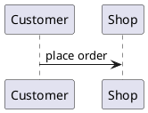

# PlantUML Diagrams

**Your PlantUML diagrams, drawn where you read them.** A `.puml` file in Nextcloud opens as a picture, edits with the diagram redrawing beside the source, and a folder README shows its diagrams instead of their code. 📐

[](https://github.com/kubed-io/nextcloud-plantuml/actions/workflows/tests.yml)
[](https://github.com/kubed-io/nextcloud-plantuml/actions/workflows/quality.yml)
[](https://github.com/kubed-io/nextcloud-plantuml/actions/workflows/integration.yml)
[](LICENSE)
[](https://apps.nextcloud.com)
[](composer.json)

---

## The whole idea, in one breath

Point the app at a PlantUML server. Every `.puml` in your Nextcloud is now a diagram, and every README that quotes or embeds one shows the picture.

```
Diagrams/
├── README.md            ← its ```plantuml fence and  are drawn
├── Order flow.puml      ← click: the diagram. Its menu: edit it, source beside picture
└── Checkout.puml
```

The app holds no diagrams of its own and the server keeps nothing. A `.puml` is an ordinary Nextcloud file: share it, version it, move it, trash it, restore it — all of that is Nextcloud's, untouched. The server only ever draws. 🖼️

---

## ✨ Click it, and it's a picture

A `.puml` file wears its own icon and opens in Nextcloud's image viewer, the same lightbox your photos use. No download, no copy-paste into a website: the diagram, drawn fresh from the file as it is right now.

A URL does the same. Ask the app for the image of a file by its path and you get the SVG back, for anyone who can read the file and for nobody else.

👀 [`diagrams/view.feature`](features/diagrams/view.feature)

---

## ✍️ Edit it, and watch it change

**Edit diagram** opens the source on the left and the diagram on the right, redrawing as you type. Drag the line between them to suit; long lines wrap, a big diagram shrinks to fit its pane, and the links in it open in a new tab.

Nothing to remember to save. Like Nextcloud's own Text, it saves a couple of seconds after you stop typing, with Text's check mark to show it, and **Ctrl/Cmd+S** saves at once if you can't wait. Change the file somewhere else, a desktop editor over WebDAV say, and the open editor picks it up. If you both changed it, you're told rather than overwritten: take theirs, or keep yours as a copy.

Highlighting knows PlantUML, Creole markup included, and follows Nextcloud's light and dark themes. Every `#hex` colour wears a swatch: click it to pick another. 🎨

Autocomplete knows your server: its themes after `!theme`, its icons after `<&`, its emoji after `<:`. It offers the arrows between two names, the Creole tags after `<`, keywords, the names already in the diagram, and whole `alt` and `loop` blocks to fill in. And the editor underlines what PlantUML would complain about: a diagram with no name, and the line with the mistake on it.

`<style>` blocks have their own editor, with choosers and steppers for values, and `!include` and `<style file=…>` read the files beside your diagram. 🎨

A file with several diagrams gets a tab for each: the picture follows your cursor, and picking a tab takes the cursor there. Blocks fold, a missing `@end` is underlined with a fix, and YAML blocks are coloured and checked. 🗂️

Prefer plain text? **Open with text editor** gives you Nextcloud's own editor on the source, as it would for any text file.

**+ New → New puml File** starts one, already holding `@startuml` and `@enduml`, and opens the editor on it.

✍️ [`diagrams/edit.feature`](features/diagrams/edit.feature) · ➕ [`diagrams/create.feature`](features/diagrams/create.feature)

---

## 📖 READMEs that draw themselves

This is the part we're smug about. 😏

Drop a README into a folder and Nextcloud shows it above the files. Put a diagram in it either way and it's drawn in place:

````markdown



````

The fence renders where it stands. The image tag renders the file beside the README, so one `.puml` can be the diagram in the viewer, the thing you edit, *and* the picture in the README, with nothing to keep in sync. The fence tag is `plantuml`, the one every other tool agrees on.

A file name with a space needs `<Order flow.puml>` as above, or `Order%20flow.puml`; Markdown ends a bare link at the space.

📖 [`readme/render.feature`](features/readme/render.feature)

---

## 🛠 Setup, in three moves

**1. Run a PlantUML server.** The official [`plantuml/plantuml-server`](https://hub.docker.com/r/plantuml/plantuml-server) image is all it takes; it needs no account and holds no state. Its own `PLANTUML_SECURITY_PROFILE` decides what diagrams may `!include`, and that's the server's setting, not this app's.

**2. Point the app at it.** Admin settings → PlantUML → the server URL.

**3. Test it.** **Test connection** reports the PlantUML version the server is running — or says which of the three things is wrong: not set, unreachable, or not a PlantUML server. Then upload a `.puml` and click it.

🔌 [`connection/admin.feature`](features/connection/admin.feature)

---

## ⌨️ Every button is also a command

The whole setup is scriptable, so a Kubernetes init job can stand the thing up with no clicking. Exit `0` on success, non-zero on failure.

```sh
occ plantuml:set-url http://plantuml.flow.svc
occ plantuml:test-connection
occ plantuml:show-config
```

---

## 📋 The specs are the docs

Every feature above links to an **executable specification** — a Gherkin `.feature` file under [`features/`](features/) written in plain language, which also *drives the integration tests* against a real Nextcloud and a real PlantUML server. They're written before the code and kept true after it: a scenario counts as done only once CI has run it green. 🧪

Read [`features/README.md`](features/README.md) for how they're organised.

---

## 📜 Licence & trademark

AGPL-3.0-or-later. See [LICENSE](LICENSE).

This is a community integration and is not affiliated with or endorsed by the PlantUML project. "PlantUML" is used here only to identify the software this app integrates with.
